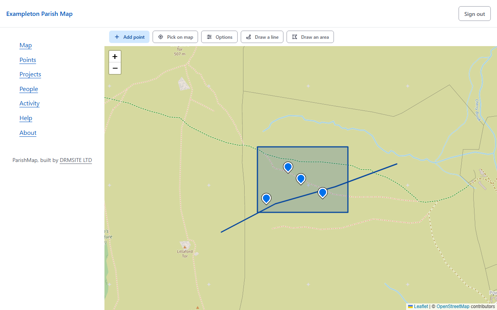
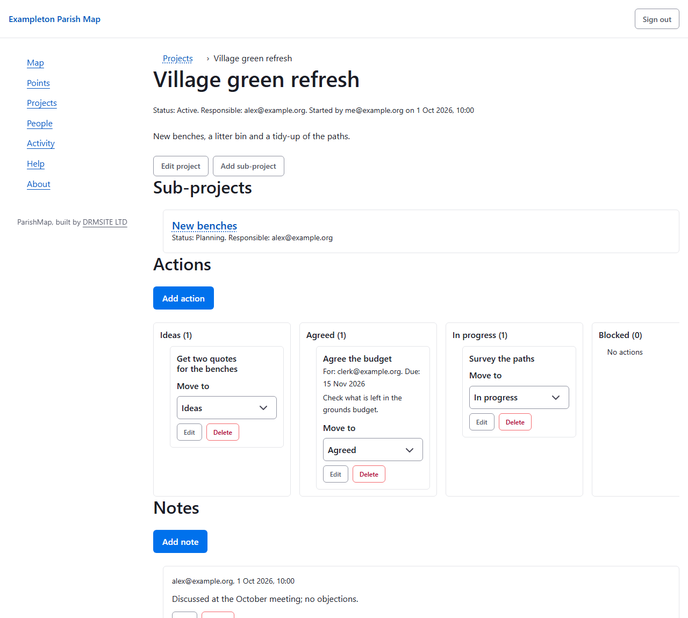

# ParishMap

[](https://github.com/DRMSITE/parishmap/actions/workflows/ci.yml)
[](LICENSE)

Much of a council's work lives in email threads and in a spreadsheet that only one person fully understands: where the bench is, who agreed to replace it, whether anyone ever got a second quote. ParishMap is a private map and project planner for **parish, town and community councils**, and it keeps the places and the projects together. Councillors and the Clerk put points, lines and areas on a map, link them to projects, and follow the council's longer pieces of work on a simple board that shows who is responsible, what has been agreed and what is stuck.

It runs in **your own Firebase project**, so your data, keys and costs stay with your council. Everything is behind sign-in, and everyone uses an authenticator app as well as a password. Nothing is public, which is rather the point.

Built by [DRMSITE LTD](https://drmsite.com) and released under the
[GNU Affero General Public Licence](LICENSE) (AGPL-3.0-or-later).

> **Status: pre-release (0.1.1).** It was built for one parish council's own use. I have followed this packaging once myself, from a fresh clone to a signed-in administrator on a new Firebase project, and fixed what I found, but nobody else has yet. The Ordnance Survey provider and the tile function's refusal of out-of-area tiles have been tested in code only, not on a live site. Expect rough edges in the set-up, and please [report them](https://github.com/DRMSITE/parishmap/issues). See [what it does not do](#what-it-does-not-do).

## What it does

In practice it comes down to five things.

- **A map** of your area, using OpenStreetMap by default (or Ordnance Survey, or another provider, if you hold a licence), with points, lines and areas, an optional council boundary and a search for places.
- **A Points page** that lists everything as text. It is the equivalent of the map for people who use a keyboard or a screen reader, and it is kept in step with the map rather than added afterwards.
- **Projects**, with sub-projects, a responsible councillor for each and a five-lane board of actions (Ideas, Agreed, In progress, Blocked, Done), plus a log of notes. Open a project from the Projects page to see its board, where each action has a **Move to** list (and Move up and Move down buttons) as well as drag and drop. Projects and actions can be linked to places on the map, and each place shows the projects that concern it.
- **Roles**: administrator, clerk, councillor and member, each allowed only what the council decides. The Clerk invites people and manages accounts on a People page, and every change is recorded on an Activity page.
- **Accessibility** aimed at WCAG 2.2 AA, with keyboard use throughout and automated checks with axe. Those checks catch a good deal, though by no means everything, so it is worth testing with your own people.

See [roles and permissions](docs/roles-and-permissions.md) for exactly who can do what.





<sub>Screenshots show a made-up council, "Exampleton", with example data.</sub>

## Is it for you?

It suits a council that wants a small, private tool it controls, and that has someone comfortable with a command line to set it up once: the Clerk's IT supplier, a volunteer, or a councillor with a technical bent. It is not a hosted service. **You** create the Firebase project, deploy it and look after it, which is the price of keeping the data yours. Costs are normally pennies a month, but you must set a budget alert (see [setting up Firebase](docs/firebase-setup.md)), because nobody else will tell you when that stops being true.

## Quick start

You need Node 24.12 or later, a Google account and the [Firebase CLI](https://firebase.google.com/docs/cli).

```bash
git clone https://github.com/DRMSITE/parishmap.git
cd parishmap
npm install
```

Then follow **[Setting up Firebase](docs/firebase-setup.md)**. Create the project first, because the next command needs its id:

```bash
npm run setup          # asks about your council; writes deployment/, .env and .firebaserc
```

The guide goes on to turn on sign-in, deploy, and make you the first administrator. If you would rather look at the interface first, run `VITE_LOCAL_DATA=true npm run dev` (on Windows PowerShell: `$env:VITE_LOCAL_DATA="true"; npm run dev`). That skips sign-in and keeps example data in your browser, so it suits development and tests only, and you should never deploy it.

## Documentation

Each page answers one question, and the first is the one most people need.

| | |
| --- | --- |
| [Setting up Firebase](docs/firebase-setup.md) | From nothing to a working site |
| [Configuration](docs/configuration.md) | Everything in `deployment/parish.config.js` |
| [Map tile providers](docs/tile-providers.md) | OpenStreetMap, Ordnance Survey and others; caching and key safety |
| [Roles and permissions](docs/roles-and-permissions.md) | Who can do what |
| [Security](docs/security.md) | How it is protected, and what it does not protect against |
| [Data protection](docs/data-protection.md) | What is stored, and a privacy notice to adapt |
| [Deploying and upgrading](docs/deploying-and-upgrading.md) | Releases, updates, the checks to run |
| [Backups and restoring](docs/backups.md) | What to switch on, and how to restore |
| [Architecture](docs/architecture.md) | How the code is organised, for contributors |
| [For the maintainers](docs/maintainers.md) | Repository settings and the release checklist |

## What it does not do

A few limits are worth knowing before you start, since each one rules out some councils.

- **It is not legal advice.** Your council is the data controller for the people and places in it, and must follow the terms of any map provider it chooses. [Data protection](docs/data-protection.md) is a starting point to check, not a finished notice.
- **It has no public side.** There is no public map and no way for residents to sign up, because a private tool is much easier to defend than one that has to tell a friend from a stranger.
- **It serves one council per deployment.** Several councils sharing a deployment is not supported.
- **It is English only** for now (UK English). The text is kept in a few modules, so translation should be possible later, though nobody has tried it.
- **It has no offline use, and it stores no map tiles on your side.** Tiles are fetched only while someone looks at the map.
- **It has no built-in rate limiting** of map requests per person, beyond a cap on server instances.

## Contributing and support

Bug reports and pull requests are welcome: see [CONTRIBUTING.md](CONTRIBUTING.md). Report security problems privately, as described in [SECURITY.md](SECURITY.md). Please be kind to each other; the project follows the [Contributor Covenant](CODE_OF_CONDUCT.md). There is no guaranteed support for this free software, but if your council would like help setting up or hosting, contact [DRMSITE LTD](https://drmsite.com).

## Licence and credits

Copyright © 2026 DRMSITE LTD. Licensed under the [AGPL-3.0-or-later](LICENSE): you may use and adapt it, and if you run a modified version for others over a network you must offer them the source. A council using it unchanged has nothing extra to do. Please keep the "Built by DRMSITE LTD" credit on the About page (see [NOTICE](NOTICE)).

Built with [Leaflet](https://leafletjs.com/), [Web Awesome](https://webawesome.com/) (free),
[Firebase](https://firebase.google.com/), [OpenStreetMap](https://www.openstreetmap.org/copyright)
data and [Font Awesome Free](https://fontawesome.com/license/free) icons. See
[THIRD_PARTY_LICENSES.md](THIRD_PARTY_LICENSES.md).
